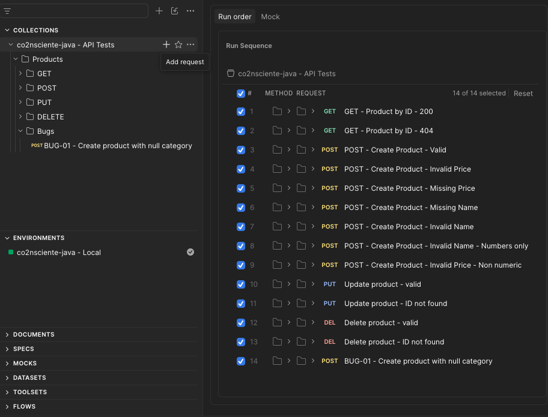
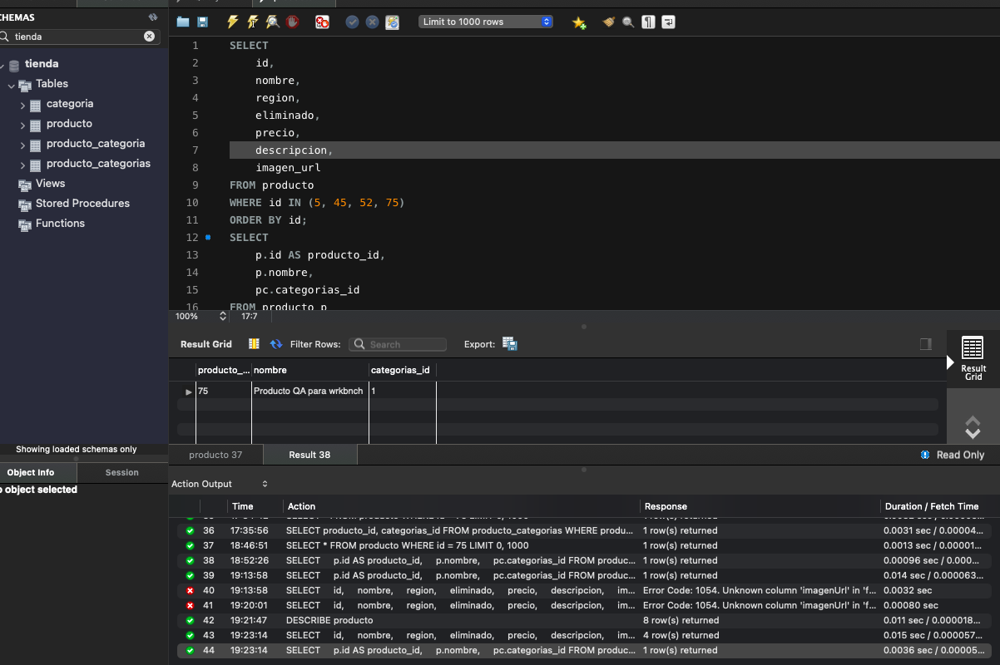

# CO2nsciente — API Testing & QA

## Descripción del proyecto

Proyecto backend desarrollado con Java y Spring Boot, conectado a una base de datos MySQL, para gestionar productos mediante una API REST.

El proyecto se utiliza como práctica de **Quality Assurance (QA)** para diseñar y ejecutar pruebas de API, validar datos, verificar la persistencia en la base de datos y documentar defectos encontrados.

> Proyecto personal de práctica. No corresponde a una experiencia con un cliente real.

## Tecnologías y herramientas

- Java 17
- Spring Boot
- Spring Data JPA
- MySQL
- MySQL Workbench
- Postman
- Google Sheets
- Maven

## Pruebas de API con Postman

Se diseñaron y ejecutaron pruebas para verificar distintos comportamientos de la API:

- **GET:** consulta de productos y búsqueda por identificador.
- **POST:** creación de productos y validación de datos de entrada.
- **PUT:** actualización de productos.
- **DELETE:** eliminación lógica de productos.
- Validación de códigos de respuesta HTTP.
- Pruebas con datos válidos, inválidos y campos obligatorios.
- Registro de comportamientos inesperados.

## Verificación de base de datos con MySQL Workbench

Se realizaron consultas SQL para comprobar:

- Correspondencia entre las respuestas de la API y los datos almacenados.
- Persistencia de productos nuevos.
- Actualización de registros.
- Eliminación lógica mediante el campo `eliminado`.
- Asociación entre productos y categorías.

## Evidencias de ejecución

### Postman — Pruebas de API

### MySQL Workbench — Verificación de datos

## Documentación de QA

La planilla contiene la documentación del trabajo realizado, incluyendo:

- Historia de usuario, regla de negocio y criterios de aceptación.
- Casos de prueba.
- Defectos identificados y sus resultados.
- Verificaciones de base de datos.

**[Consultar la planilla de QA en Google Sheets](https://docs.google.com/spreadsheets/d/e/2PACX-1vQLmufcNJ4bV08u66loHUplYiMngSRHOW75r5wC53yv1lO_9727dZohpTuO4Z_w8_ynBNh4nzkAYyEt/pubhtml)**

## Objetivo del proyecto

Demostrar práctica en pruebas de API REST, diseño y ejecución de casos de prueba, validación de datos, consultas SQL y documentación de defectos como parte de mi portfolio de QA.
